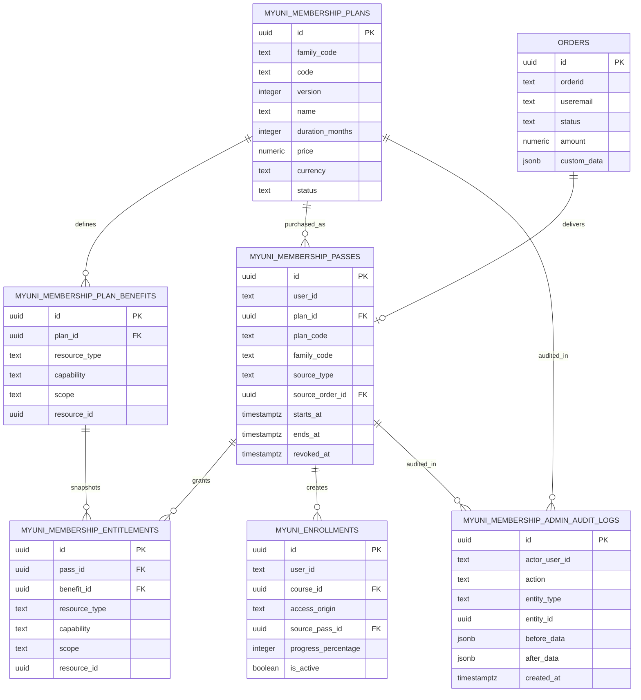
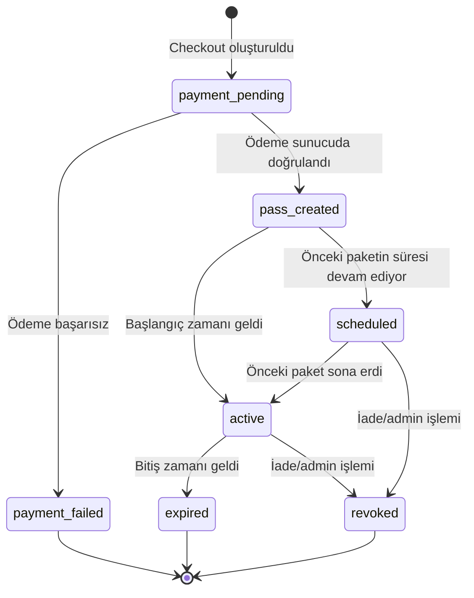
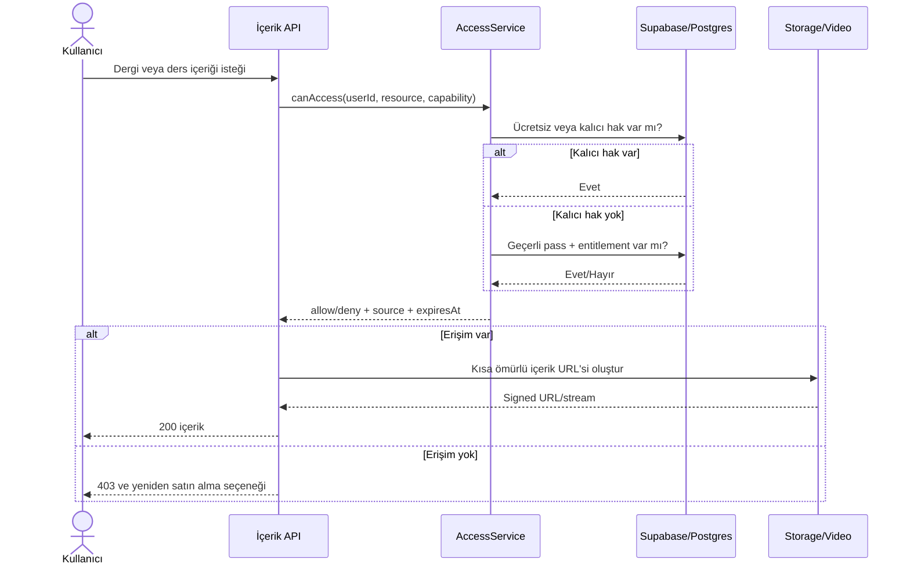
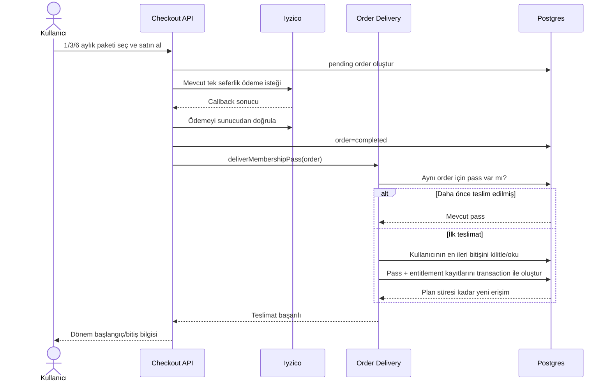
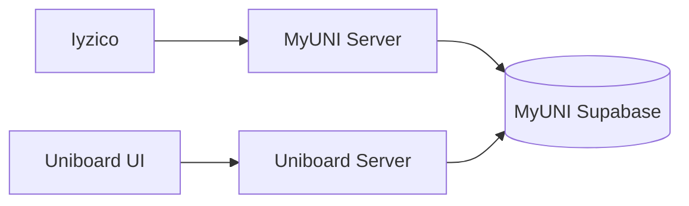

# MyUNI Çoklu Süreli Üyelik Erişim Paketi Mimarisi

## 1. Ödeme kısıtı ve çözüm

Mevcut ödeme yöntemi otomatik yenilenen abonelikleri desteklemiyor. Bu nedenle MyUNI üyeliği teknik olarak bir subscription değil, **tek seferlik ödemeyle satın alınan 1, 3 veya 6 aylık erişim paketleri** olarak modellenir.

Kullanıcı deneyiminde “1 Aylık”, “3 Aylık” ve “6 Aylık MyUNI Üyeliği” seçenekleri sunulur. Teknik davranış şöyledir:

1. Kullanıcı mevcut Iyzico ödeme akışıyla tek seferlik ödeme yapar.
2. Doğrulanmış başarılı sipariş, seçilen planın `duration_months` değeri kadar bir `membership_pass` oluşturur.
3. Süre dolduğunda yeni ödeme alınmaz ve erişim kendiliğinden kapanır.
4. Kullanıcı yeniden satın alırsa süresi mevcut bitiş tarihinin sonuna eklenir.
5. Süre sonuna yaklaşınca yalnızca hatırlatma gönderilir; otomatik tahsilat yapılmaz.

Bu yaklaşım ödeme sağlayıcısının sunmadığı recurring davranışını taklit etmez ve mevcut ödeme altyapısını korur.

## 2. Temel ürün kararları

| Konu | Davranış |
| --- | --- |
| Ürün tipi | Tek seferlik ödenen süreli erişim paketi |
| Paket seçenekleri | Başlangıçta 1, 3 ve 6 takvim ayı; Uniboard'dan yeni süre eklenebilir |
| Otomatik yenileme | Yok |
| Yenileme | Kullanıcı yeni bir tek seferlik sipariş verir |
| Erken yenileme | Satın alınan plan süresi mevcut en ileri bitiş tarihine eklenir |
| İptal | Gelecek tahsilat olmadığı için abonelik iptali yoktur |
| İade | İlgili erişim paketi `revoked` yapılır |
| Dergiler | Geçerli erişim döneminde okunur |
| Eğitimler | Geçerli erişim döneminde izlenir; ilerleme süresiz korunur |
| Sertifika kazanma | Erişim dönemi geçerliyken ve eğitim koşulları tamamlandığında mümkündür |
| Oluşturulmuş sertifika | Paket süresi dolduktan sonra da kalıcı ve doğrulanabilir kalır |
| Tekil satın alma/hediye | Üyelik paketinden bağımsız, kalıcı hak olmaya devam eder |
| Yeni katalog içeriği | Plan faydası `catalog` ise geçerli paket sahiplerine otomatik açılır |

Süreler sabit gün sayısıyla değil takvim ayıyla hesaplanır. Örneğin üç aylık plan `make_interval(months => 3)` kullanır.

## 3. Mevcut sisteme uyum

Mevcut erişim ve ödeme kaynakları:

- Tek seferlik ödemeler: `orders` ve mevcut Iyzico ödeme akışı
- Dergi/dijital ürün: `myuni_products_purchases`
- Eğitim: `myuni_enrollments`
- Etkinlik: `myuni_event_enrollments`
- Eğitim sertifikası: `myuni_certificates`
- Etkinlik sertifikası: `myuni_event_certificates`

Yeni paket ödemesi de `orders` tablosunda tutulur. Siparişin sunucu tarafından oluşturulan `custom_data` alanında aşağıdaki bilgiler bulunur:

```json
{
  "itemType": "membership_pass",
  "membershipPlan": {
    "planId": "uuid",
    "code": "MYUNI_3_MONTHS",
    "familyCode": "MYUNI_ACCESS",
    "version": 1,
    "durationMonths": 3,
    "price": 1000,
    "currency": "TRY"
  }
}
```

Fiyat, süre ve plan kapsamı istemciden kabul edilmez. Sunucu `planId` üzerinden yayınlanmış planı okuyarak sipariş anlık görüntüsünü oluşturur.

## 4. Neden mevcut tablolara yalnızca `expires_at` eklemiyoruz?

`myuni_enrollments` hem eğitim kaydını hem ilerlemeyi temsil ediyor. Paket süresi sonunda kaydı pasifleştirmek ilerlemeyi görünmez hale getirir; aktif bırakmak ise eğitime süresiz erişim verir.

Bu nedenle:

- Mevcut tablolar kalıcı satın almaları ve öğrenme geçmişini korur.
- Süreli haklar `membership_pass` ve `membership_entitlement` tablolarında tutulur.
- İçerik API'leri kararı merkezi bir `AccessService` üzerinden verir.
- Paket üzerinden açılan enrollment kaydı, `source_pass_id` ile kaynağını belirtir.

## 5. Kavramsal model

### 5.1 Plan

Satılan erişim paketinin adını, fiyatını, süresini ve sürümünü tanımlar. `family_code`, farklı sürelerdeki paketleri aynı kesintisiz erişim ailesinde birleştirir. Yayınlanmış bir plan değiştirilmez; fiyat veya kapsam değişikliğinde yeni plan sürümü yayınlanır.

### 5.2 Plan faydası

Planın hangi kaynağa hangi yetkiyi verdiğini tanımlar:

- `resource_type`: `product`, `course`, `event`
- `capability`: `view`, `participate`, `certificate`
- `scope`: `catalog` veya `specific`
- `resource_id`: Yalnızca `specific` kapsamda doludur

### 5.3 Erişim paketi

Başarılı tek seferlik siparişin kullanıcıya verdiği zaman aralığıdır. Bir sipariş en fazla bir erişim paketi oluşturabilir.

### 5.4 Entitlement

Satın alma anındaki plan faydalarının erişim paketine kopyalanmış halidir. Böylece plan daha sonra arşivlense veya yeni sürüm yayınlansa bile satın alınan kapsam değişmez.

## 6. ER/UML diyagramı



`resource_id` farklı katalog tablolarını gösterebildiği için doğrudan foreign key değildir. `specific` fayda kaydedilirken kaynağın varlığı uygulama veya admin API sınırında doğrulanır.

## 7. Erişim paketinin durum modeli

`active`, `scheduled` ve `expired` ayrı bir status kolonunda tutulmak zorunda değildir; `starts_at`, `ends_at` ve `revoked_at` üzerinden türetilir. Böylece durum güvenliği cron görevine bağlı olmaz.



Türetilen durumlar:

```text
revoked   = revoked_at IS NOT NULL
scheduled = revoked_at IS NULL AND now() < starts_at
active    = revoked_at IS NULL AND starts_at <= now() AND now() < ends_at
expired   = revoked_at IS NULL AND now() >= ends_at
```

## 8. İlk satın alma ve manuel yenileme

İlk satın almada:

```text
starts_at = now()
ends_at   = starts_at + plan.duration_months takvim ayı
```

Aynı `family_code` içindeki herhangi bir süre paketi yeniden satın alındığında:

```text
coverage_anchor = greatest(now(), kullanıcının en ileri geçerli ends_at değeri)
starts_at        = coverage_anchor
ends_at          = coverage_anchor + plan.duration_months takvim ayı
```

Örnek:

- Mevcut paket bitişi: 15 Ağustos
- Kullanıcının yeni 3 aylık paket satın alma tarihi: 1 Temmuz
- Yeni paket başlangıcı: 15 Ağustos
- Yeni paket bitişi: 15 Kasım

Aynı kullanıcı için eş zamanlı iki başarılı ödeme işlenirken dönemlerin üst üste binmemesi için teslimat işlemi `user_id + plan.family_code` anahtarında transaction/advisory lock ile seri hale getirilir.

## 9. Önerilen SQL şeması

Aşağıdaki DDL uygulama migration'ı için başlangıç sözleşmesidir. Üretime uygulanmadan önce RLS politikaları ve `orders.id` tipinin canlı şemayla uyumu tekrar doğrulanmalıdır.

```sql
create table myuni_membership_plans (
  id uuid primary key default gen_random_uuid(),
  family_code text not null,
  code text not null,
  version integer not null default 1 check (version > 0),
  name text not null,
  description text,
  duration_months integer not null check (duration_months between 1 and 24),
  price numeric(12, 2) not null check (price >= 0),
  currency text not null default 'TRY' check (char_length(currency) = 3),
  sort_order integer not null default 0,
  is_featured boolean not null default false,
  status text not null default 'draft'
    check (status in ('draft', 'published', 'archived')),
  published_at timestamptz,
  created_at timestamptz not null default now(),
  updated_at timestamptz not null default now(),
  unique (code, version)
);

create table myuni_membership_plan_benefits (
  id uuid primary key default gen_random_uuid(),
  plan_id uuid not null references myuni_membership_plans(id),
  resource_type text not null
    check (resource_type in ('product', 'course', 'event')),
  capability text not null
    check (capability in ('view', 'participate', 'certificate')),
  scope text not null check (scope in ('catalog', 'specific')),
  resource_id uuid,
  created_at timestamptz not null default now(),
  check (
    (scope = 'catalog' and resource_id is null)
    or (scope = 'specific' and resource_id is not null)
  )
);

create unique index myuni_plan_benefits_catalog_unique
  on myuni_membership_plan_benefits (plan_id, resource_type, capability)
  where scope = 'catalog';

create unique index myuni_plan_benefits_specific_unique
  on myuni_membership_plan_benefits
  (plan_id, resource_type, capability, resource_id)
  where scope = 'specific';

create table myuni_membership_passes (
  id uuid primary key default gen_random_uuid(),
  user_id text not null,
  plan_id uuid not null references myuni_membership_plans(id),
  plan_code text not null,
  family_code text not null,
  source_type text not null default 'order'
    check (source_type in ('order', 'admin', 'campaign')),
  source_order_id uuid references orders(id),
  created_by text,
  starts_at timestamptz not null,
  ends_at timestamptz not null,
  purchased_at timestamptz not null default now(),
  revoked_at timestamptz,
  revoke_reason text,
  created_at timestamptz not null default now(),
  check (ends_at > starts_at),
  check (source_type <> 'order' or source_order_id is not null)
);

create unique index myuni_membership_passes_order_unique
  on myuni_membership_passes (source_order_id)
  where source_order_id is not null;

create index myuni_membership_passes_access_idx
  on myuni_membership_passes (user_id, starts_at, ends_at)
  where revoked_at is null;

create index myuni_membership_passes_plan_idx
  on myuni_membership_passes (user_id, family_code, ends_at)
  where revoked_at is null;

create table myuni_membership_entitlements (
  id uuid primary key default gen_random_uuid(),
  pass_id uuid not null references myuni_membership_passes(id),
  benefit_id uuid not null references myuni_membership_plan_benefits(id),
  resource_type text not null
    check (resource_type in ('product', 'course', 'event')),
  capability text not null
    check (capability in ('view', 'participate', 'certificate')),
  scope text not null check (scope in ('catalog', 'specific')),
  resource_id uuid,
  created_at timestamptz not null default now(),
  check (
    (scope = 'catalog' and resource_id is null)
    or (scope = 'specific' and resource_id is not null)
  ),
  unique (pass_id, benefit_id)
);

create index myuni_membership_entitlements_lookup_idx
  on myuni_membership_entitlements
  (resource_type, capability, resource_id, pass_id);

alter table myuni_enrollments
  add column access_origin text not null default 'legacy_permanent'
    check (
      access_origin in (
        'legacy_permanent', 'purchase', 'gift', 'free',
        'membership_pass', 'admin'
      )
    ),
  add column source_pass_id uuid references myuni_membership_passes(id);

create index myuni_enrollments_pass_idx
  on myuni_enrollments (source_pass_id)
  where source_pass_id is not null;

create table myuni_membership_admin_audit_logs (
  id uuid primary key default gen_random_uuid(),
  actor_user_id text not null,
  actor_email text not null,
  action text not null,
  entity_type text not null,
  entity_id uuid not null,
  before_data jsonb,
  after_data jsonb,
  reason text,
  created_at timestamptz not null default now()
);

create index myuni_membership_admin_audit_entity_idx
  on myuni_membership_admin_audit_logs
  (entity_type, entity_id, created_at desc);

create index myuni_membership_admin_audit_actor_idx
  on myuni_membership_admin_audit_logs
  (actor_user_id, created_at desc);
```

Etkinlikler üyelik paketine dahil edilecekse `access_origin` ve `source_pass_id` kolonları `myuni_event_enrollments` tablosuna da eklenir.

İlk paket kataloğu aynı aile altında üç ayrı plan olarak açılır:

| `family_code` | `code` | `duration_months` | Yönetim |
| --- | --- | ---: | --- |
| `MYUNI_ACCESS` | `MYUNI_1_MONTH` | 1 | Uniboard'dan fiyat/kapsam/yayın durumu |
| `MYUNI_ACCESS` | `MYUNI_3_MONTHS` | 3 | Uniboard'dan fiyat/kapsam/yayın durumu |
| `MYUNI_ACCESS` | `MYUNI_6_MONTHS` | 6 | Uniboard'dan fiyat/kapsam/yayın durumu |

Üç planın faydaları aynı olabilir; yine de ayrı satırlar olarak kopyalanır. Böylece ileride belirli süreye özel kapsam veya kampanya tanımlanabilir.

## 10. Merkezi erişim sözleşmesi

```ts
type AccessRequest = {
  userId: string;
  resourceType: 'product' | 'course' | 'event';
  resourceId: string;
  capability: 'view' | 'participate' | 'certificate';
};

type AccessDecision = {
  allowed: boolean;
  source: 'free' | 'purchase' | 'gift' | 'membership_pass' | 'admin' | null;
  expiresAt: string | null;
  passId: string | null;
  reason: 'granted' | 'scheduled' | 'expired' | 'revoked' | 'not_entitled';
};
```

Karar sırası:

1. Kaynak ücretsizse izin ver.
2. Kalıcı satın alma, hediye veya admin hakkı varsa izin ver.
3. `starts_at <= now() < ends_at` koşulunu sağlayan, revoke edilmemiş pass ve eşleşen entitlement varsa izin ver.
4. Yalnızca gelecekte başlayacak pass varsa `scheduled` bilgisi döndür.
5. Hiçbiri yoksa `403` döndür.

## 11. İçerik erişim akışı



PDF, video, not ve sertifika oluşturma API'leri sunucu tarafında aynı `AccessService` kararını kullanmalıdır. UI'da buton gizlemek güvenlik kontrolü değildir.

## 12. Ödeme ve pass teslimat akışı



Frontend başarı sayfası pass oluşturamaz. Teslimat yalnızca sunucu tarafından doğrulanmış ödeme sonrasında yapılır. Sipariş kaynaklı pass kayıtlarında `source_order_id` benzersiz olduğu için callback, reconciliation veya admin düzeltme işlemi tekrar çalışsa bile ikinci pass oluşmaz.

## 13. Mevcut sipariş teslimatına entegrasyon

`lib/orderDelivery.ts` yeni bir teslimat türü tanır:

```text
item.type = membership_pass
```

Teslimat sorumlulukları:

1. Siparişin `completed` olduğunu doğrula.
2. Planın sipariş anındaki kimlik ve sürümünü doğrula.
3. `source_order_id` ile idempotency kontrolü yap.
4. Kullanıcının aynı plan ailesindeki en ileri geçerli bitişini transaction içinde bul.
5. Yeni `starts_at` ve `ends_at` değerlerini hesapla.
6. Plan faydalarını entitlement satırlarına kopyala.
7. Pass ve entitlement kayıtlarını aynı transaction içinde commit et.

Mevcut ödeme rotasına ikinci bir ödeme sağlayıcısı veya recurring SDK eklenmez.

## 14. Sertifika kuralı

Yeni sertifika oluşturmak için iki koşul birlikte sağlanır:

```text
eğitim tamamlama koşulları sağlandı
AND
(kalıcı sertifika hakkı var OR geçerli certificate entitlement var)
```

Pass süresi dolduğunda:

- Yeni sertifika oluşturulamaz.
- Önceden oluşturulan sertifika görüntülenebilir ve doğrulanabilir.
- Eğitim ilerlemesi ve sınav sonuçları silinmez.

## 15. Uniboard yönetim modülü

### 15.1 Veri sahipliği

Plan, pass ve entitlement tablolarının tek kaynağı MyUNI erişim veritabanıdır. Uniboard aynı kayıtların ikinci bir kopyasını tutmaz.

Tercih edilen bağlantı:



Uniboard tarayıcısı service-role anahtarını görmez. Veritabanı çağrıları yalnızca Uniboard sunucu route/service katmanından yapılır. Mümkünse sadece üyelik tablolarına yetkili ayrı bir PostgreSQL rolü kullanılır; ilk aşamada service-role kullanılacaksa anahtar yalnızca sunucu ortam değişkeninde tutulur.

İki uygulamanın aynı veritabanına güvenli sunucu bağlantısı kuramadığı ortamda alternatif, MyUNI üzerinde HMAC secret ile korunan dahili admin API'dir. İki veritabanına çift yazım yapılmaz.

### 15.2 Modül ekranları

| Uniboard ekranı | İçerik ve işlemler |
| --- | --- |
| Genel Bakış | Aktif kullanıcı, sıradaki pass, 7/30 günde bitecek erişim, paket bazlı satış ve gelir |
| Paketler | 1/3/6 aylık planlar, fiyat, süre, kapsam, sıralama, öne çıkarma ve yayın durumu |
| Erişimler | Kullanıcı, plan, kaynak, başlangıç/bitiş, türetilmiş durum ve sipariş filtreleri |
| Kullanıcı Detayı | Satın alma/pass zaman çizelgesi, kalıcı haklar, ilerleme ve sertifikalar |
| Süresi Dolacaklar | 14 gün, 3 gün ve bugün bitecek kullanıcı listeleri |
| İşlem Geçmişi | Plan yayınlama, manuel tanımlama, uzatma ve revoke audit kayıtları |

### 15.3 Plan yönetimi

- Yeni plan önce `draft` oluşturulur.
- Süre `1..24` ay aralığında pozitif tam sayıdır; 1/3/6 sabit kodlanmaz.
- Fiyat, para birimi, kapsam, sıralama ve öne çıkarma Uniboard'dan düzenlenir.
- `published` planın fiyatı, süresi ve kapsamı yerinde değiştirilmez.
- Değişiklik gerektiğinde plan klonlanır, `version` artırılır ve yeni sürüm yayınlanır.
- Eski sürüm `archived` yapılabilir; mevcut pass ve entitlement kayıtları etkilenmez.
- Aynı anda aynı `code` için yalnızca bir yayınlanmış sürüm bulunur.

Bu son kural migration'da partial unique index ile korunmalıdır:

```sql
create unique index myuni_membership_plans_one_published_version
  on myuni_membership_plans (code)
  where status = 'published';
```

### 15.4 Pass yönetimi

Uniboard yetkili kullanıcısı:

- Siparişten doğan pass kaydını ve kaynak siparişi görüntüleyebilir.
- Destek/kampanya gerekçesiyle manuel pass tanımlayabilir.
- Süre uzatırken mevcut satırı değiştirmek yerine `source_type = 'admin'` olan yeni pass oluşturur.
- İade veya kötüye kullanım halinde ilgili pass'i gerekçeyle revoke edebilir.
- Kalıcı satın alma veya kazanılmış sertifikayı üyelik işlemi sırasında silemez.

Manuel işlem de ödeme teslimatıyla aynı tarih hesaplama fonksiyonunu kullanır. Böylece Uniboard ve MyUNI farklı süre hesaplamaz.

### 15.5 Yetkiler

| Capability | Yetki |
| --- | --- |
| `membership.view` | Dashboard, plan ve pass kayıtlarını görüntüleme |
| `membership.plan.manage` | Draft oluşturma, yeni sürüm yayınlama, arşivleme |
| `membership.pass.grant` | Kullanıcıya manuel süre tanımlama/uzatma |
| `membership.pass.revoke` | Pass erişimini gerekçeyle geri alma |
| `membership.audit.view` | Audit kayıtlarını görüntüleme |
| `membership.report.export` | Filtrelenmiş rapor dışa aktarma |

Yetki kontrolleri yalnızca menü görünürlüğünde değil, her Uniboard API route'unda sunucu tarafında yapılır.

### 15.6 Uniboard API sözleşmesi

| Method | Path | Capability | Amaç |
| --- | --- | --- | --- |
| `GET` | `/api/admin/memberships/stats` | `membership.view` | Dashboard metrikleri |
| `GET` | `/api/admin/memberships/plans` | `membership.view` | Plan ve sürümleri listeler |
| `POST` | `/api/admin/memberships/plans` | `membership.plan.manage` | Draft plan oluşturur |
| `POST` | `/api/admin/memberships/plans/:id/publish` | `membership.plan.manage` | Plan sürümünü yayınlar |
| `POST` | `/api/admin/memberships/plans/:id/archive` | `membership.plan.manage` | Plan sürümünü satıştan kaldırır |
| `GET` | `/api/admin/memberships/passes` | `membership.view` | Sayfalı ve filtreli pass listesi |
| `POST` | `/api/admin/memberships/passes/grant` | `membership.pass.grant` | Manuel pass/uzatma oluşturur |
| `POST` | `/api/admin/memberships/passes/:id/revoke` | `membership.pass.revoke` | Pass'i gerekçeyle geri alır |
| `GET` | `/api/admin/memberships/audit` | `membership.audit.view` | Sayfalı işlem geçmişi |

Liste endpoint'leri cursor veya mevcut Uniboard standardındaki limit/offset ile sayfalanır. Manuel grant/revoke isteklerinde `reason` zorunludur ve işlemle audit kaydı aynı transaction içinde yazılır.

### 15.7 Dashboard metrikleri

İlk sürümde cache veya materialized view gerekli değildir. İndeksli sorgularla şu metrikler hesaplanır:

- Şu anda erişimi olan benzersiz kullanıcı sayısı
- Gelecekte başlayacak pass sayısı
- 7 ve 30 gün içinde bitecek kullanıcı sayısı
- 1/3/6 aylık paket bazında adet ve gelir
- Günlük/haftalık/aylık yeni satış
- Manuel tanımlanan ve revoke edilen pass sayısı
- Yeniden satın alma oranı

Veri büyüdüğünde günlük özet tablo eklenebilir; ilk sürümde ihtiyaç olmadan eklenmez.

## 16. API taslağı

| Method | Path | Amaç |
| --- | --- | --- |
| `GET` | `/api/membership/plans` | Yayındaki 1/3/6 aylık ve sonradan eklenen paketleri listeler |
| `GET` | `/api/membership/me` | Aktif, sıradaki ve geçmiş pass dönemlerini döndürür |
| `POST` | `/api/membership/checkout` | Mevcut Iyzico akışıyla tek seferlik ödeme başlatır |
| `POST` | `/api/iyzico-payment` | Mevcut ödeme rotası; `membership_pass` item tipini destekler |
| `GET` | `/api/access/check` | Belirli kaynak için erişim kararı döndürür |

`cancel` ve `resume` endpoint'leri yoktur; çünkü otomatik yenileme veya gelecek tahsilat bulunmaz. İade/revoke işlemi mevcut admin ve ödeme uzlaştırma akışından yürütülür.

## 17. Hatırlatma süreci

Otomatik tahsilat yerine kullanıcıya yeniden satın alma bağlantısı gönderilir:

| Zaman | Bildirim |
| --- | --- |
| Bitişe 14 gün | Üyelik erişimin yakında sona erecek |
| Bitişe 3 gün | Erişimini kesintisiz sürdürmek için yeniden satın al |
| Bitiş günü | Erişim süren sona erdi |

Hatırlatma görevi başarısız olsa bile erişim güvenliği etkilenmez. Erişim her istekte pass tarihleriyle hesaplanır. Aynı bildirim türü için `(pass_id, notification_type)` benzersizliği kullanılarak çift e-posta engellenmelidir.

## 18. RLS ve güvenlik

- Kullanıcı yalnızca kendi pass özetini okuyabilir.
- Yalnızca `published` planlar checkout işleminde kullanılabilir.
- Pass ve entitlement yazımları yalnızca service role üzerinden yapılır.
- Clerk `user_id`, istemci body içinden değil sunucu oturumundan alınır.
- Plan fiyatı ve süresi istemci verisinden alınmaz.
- Ödeme callback'i sunucudan doğrulanmadan pass oluşturulmaz.
- Sipariş kaynaklı pass kayıtlarında `source_order_id` unique index teslimatı idempotent yapar.
- Eş zamanlı yenilemeler kullanıcı ve `family_code` bazında kilitlenir.
- Uniboard manuel işlemleri yetki, zorunlu gerekçe ve audit transaction'ı olmadan çalışmaz.
- PDF/video için kalıcı public URL verilmez; erişim kontrolünden sonra kısa ömürlü signed URL üretilir.

## 19. Yumuşak geçiş planı

Geçiş sırası, mevcut satın alma ve erişim sistemini çalışır halde tutacak şekilde aşağıdaki fazlara ayrılır. Her faz bağımsız deploy edilebilir ve sonraki faz açılmadan önce kendi çıkış kriterini karşılamalıdır.

### 19.1 Faz 0 — Ürün sözleşmesini dondurma

**Amaç:** Kod ve migration başlamadan değişmeyecek kuralları netleştirmek.

Kararlaştırılacaklar:

- İlk paketler: 1, 3 ve 6 ay.
- Ortak aile: `MYUNI_ACCESS`.
- Her paketin katalog veya seçili içerik kapsamı.
- Sertifikanın kazanıldıktan sonra kalıcı olması.
- Erken yenilemede sürenin mevcut bitişe eklenmesi.
- Kullanıcının en fazla 24 ay ileri tarihli erişim biriktirebilmesi.
- İade halinde mevcut ve sıradaki pass kayıtlarına uygulanacak politika.
- İlk sürümde etkinliklerin pakete dahil olup olmayacağı.

Hazırlanacak feature flag'ler:

```text
MEMBERSHIP_READ_ENABLED=false
MEMBERSHIP_CHECKOUT_ENABLED=false
MEMBERSHIP_ADMIN_ENABLED=false
MEMBERSHIP_REMINDERS_ENABLED=false
```

**Çıkış kriteri:** Ürün kararları onaylanmış, plan kapsam listesi hazırlanmış ve feature flag isimleri iki uygulamada da tanımlanmış olmalı.

### 19.2 Faz 1 — Additive veritabanı migration'ı

**Amaç:** Henüz hiçbir mevcut sorgunun davranışını değiştirmeden yeni veri modelini hazırlamak.

Yapılacaklar:

1. `myuni_membership_plans` tablosunu oluştur.
2. `myuni_membership_plan_benefits` tablosunu oluştur.
3. `myuni_membership_passes` tablosunu oluştur.
4. `myuni_membership_entitlements` tablosunu oluştur.
5. `myuni_membership_admin_audit_logs` tablosunu oluştur.
6. `myuni_enrollments` tablosuna `access_origin` ve `source_pass_id` kolonlarını ekle.
7. Etkinlikler kapsama dahilse aynı kaynak kolonlarını `myuni_event_enrollments` tablosuna ekle.
8. Foreign key, partial unique index ve erişim indekslerini oluştur.
9. RLS politikalarını fail-closed olarak ekle.
10. Yeni tablolar için güncel TypeScript/Supabase tiplerini üret.

Migration kuralları:

- Mevcut tablo veya kolon silinmez.
- Mevcut enrollment satırları `legacy_permanent` varsayılanıyla çalışmaya devam eder.
- İlk migration hiçbir kullanıcıya pass veya entitlement oluşturmaz.
- Published plan index'i ve `source_order_id` idempotency index'i migration içinde bulunur.
- Migration önce staging/veritabanı kopyasında uygulanır.

Doğrulamalar:

```text
Mevcut ürün satın alımları aynı sayıda mı?
Mevcut aktif enrollment sayısı değişti mi?
Yeni tablolar boş mu?
Anon/authenticated roller yeni tablolara yazabiliyor mu? (Hayır)
Service role kontrollü yazabiliyor mu? (Evet)
```

**Geri dönüş:** Yeni tablolar kullanılmadığı için uygulama flag'leri kapalı tutulur. Sorun halinde uygulama eski şemayı kullanmaya devam eder; aynı deploy içinde mevcut kolonlar geri alınmaz.

**Çıkış kriteri:** Migration staging ve production'da hatasız, mevcut kullanıcı erişim sayıları değişmemiş ve RLS testleri başarılı olmalı.

### 19.3 Faz 2 — Atomik pass teslimat RPC'si

**Amaç:** Başarılı bir siparişin aynı anda yalnızca bir pass üretmesini ve sürelerin çakışmamasını sağlamak.

Supabase istemcisi birden fazla tablo yazımını uygulama tarafından tek transaction olarak yönetemediği için veritabanında tek bir RPC/fonksiyon kullanılır:

```text
deliver_membership_pass(
  order_id
) -> pass_id, starts_at, ends_at, already_delivered
```

RPC transaction içinde:

1. Siparişin başarılı/completed olduğunu doğrular.
2. `user_id`, `plan_id`, `plan_version` ve doğrulanmış `paid_at` değerini sipariş snapshot'ından çözer.
3. Planın sipariş anındaki sürümünü ve süresini doğrular.
4. `source_order_id` için mevcut pass varsa onu döndürür.
5. `user_id + family_code` için transaction-level advisory lock alır.
6. Revoke edilmemiş pass kayıtlarındaki en ileri `ends_at` değerini bulur.
7. Başlangıcı `greatest(paid_at, max(ends_at))` olarak hesaplar.
8. Bitişi `starts_at + make_interval(months => duration_months)` olarak hesaplar.
9. Toplam ileri erişimin 24 ay sınırını aşmadığını doğrular.
10. Pass kaydını oluşturur.
11. Plan faydalarını entitlement snapshot satırlarına kopyalar.
12. Pass ve entitlement kayıtlarını birlikte commit eder.

Güvenlik:

- RPC public/anon rollere açık olmaz.
- Yalnızca backend service role çağırır.
- `price`, `duration_months`, `family_code` ve faydalar request body'sinden alınmaz.
- Hata halinde pass veya entitlement'ın hiçbiri oluşmaz.

Testler:

- Aynı order 10 kez çağrıldığında tek pass oluşması.
- Aynı kullanıcıya eş zamanlı iki farklı başarılı order teslim edilmesi.
- 1 aylık aktif pass üzerine 3 aylık pass eklenmesi.
- Süresi bitmiş kullanıcıya yeni pass'in `now()` anında başlaması.
- 24 ay sınırının aşılmasının reddedilmesi.
- Draft planla checkout oluşturulamaması.
- Checkout sonrasında arşivlenen planın, ödeme zaten başlatıldığı için sipariş snapshot'ıyla teslim edilebilmesi.

**Çıkış kriteri:** RPC concurrency ve idempotency testleri başarılı; yarım kalmış pass/entitlement kaydı üretilemiyor olmalı.

### 19.4 Faz 3 — Merkezi `AccessService`

**Amaç:** Kalıcı satın alma ile süreli pass erişimini tek karar noktasında birleştirmek.

Önerilen servis sorumlulukları:

```text
canAccessResource(request) -> AccessDecision
getActivePasses(userId) -> pass[]
getUpcomingPasses(userId) -> pass[]
getMembershipSummary(userId) -> summary
```

`canAccessResource` sırası:

1. Ücretsiz içerik kontrolü.
2. Kalıcı satın alma/hediye/admin hakkı kontrolü.
3. Aktif pass + eşleşen entitlement kontrolü.
4. Gelecekte başlayacak pass kontrolü.
5. `allowed`, `source`, `expiresAt` ve güvenli `reason` sonucu.

Uygulama ayrıntıları:

- Her istek için Clerk `user_id` sunucu oturumundan alınır.
- Endpoint'ler tablo sorgularını kendileri tekrar etmez.
- `SELECT *` yerine gereken kolonlar seçilir.
- Erişim sorgusu tek veya sabit sayıda DB isteğiyle tamamlanır.
- Request log'larında e-posta veya ödeme payload'ı bulunmaz.
- Üyelik kaynaklı enrollment, pass sona erdiğinde silinmez; yalnızca içerik erişimi reddedilir.

Test matrisi:

| Kalıcı hak | Aktif pass | Sonuç |
| --- | --- | --- |
| Var | Yok | İzin |
| Yok | Var ve entitlement eşleşiyor | İzin |
| Yok | Var ama kapsam eşleşmiyor | Red |
| Yok | Süresi bitmiş | Red |
| Yok | Gelecekte başlayacak | Red + `scheduled` |
| Var | Revoke pass | Kalıcı haktan izin |

**Çıkış kriteri:** Servis birim testleri, sınır zamanı testleri ve kullanıcı izolasyonu testleri başarılı olmalı.

### 19.5 Faz 4 — Shadow mode ve korunan endpoint geçişi

**Amaç:** Yeni erişim motorunu satış açılmadan ve kullanıcı davranışını değiştirmeden doğrulamak.

İlk deploy'da `MEMBERSHIP_READ_ENABLED=false` kalır. AccessService mevcut kalıcı hak kararını hesaplar; yeni pass kararı yalnızca tanılama metriği olarak karşılaştırılır.

Sonra endpoint'ler sırayla merkezi servise geçirilir:

1. `/api/collection/check-purchase`
2. `/api/collection/my-purchases`
3. `/api/collection/my-purchased-products`
4. `/api/collection/pdf-proxy`
5. `/api/courses/lessons/[lessonId]/content`
6. `/api/enrollments/me`
7. Sertifika eligibility/generate endpoint'leri
8. Etkinlik içerik endpoint'leri, paket kapsamındaysa

Her endpoint için testler:

- `401`: Oturum yok.
- `403`: Kullanıcı oturumlu fakat hakkı yok.
- `200`: Kalıcı satın alma var.
- `200`: Aktif pass hakkı var.
- Süre bitim anında `403`.
- Başka kullanıcının resource/pass kimliğiyle erişimde `403`.

Yayın yöntemi:

1. Merkezi servis deploy edilir, flag kapalıdır.
2. Mevcut kalıcı erişim smoke testleri yapılır.
3. Sadece admin/test hesapları için flag açılır.
4. PDF ve ders içeriği doğrudan URL testleri yapılır.
5. Hata oranı ve DB sorgu süresi izlenir.

**Geri dönüş:** `MEMBERSHIP_READ_ENABLED=false` yapılır; kalıcı satın alma akışı çalışmaya devam eder.

**Çıkış kriteri:** Mevcut erişimlerde regresyon yok, test pass'i doğru zamanda erişim açıp kapatıyor ve endpoint hata oranı normal seviyede olmalı.

### 19.6 Faz 5 — Plan okuma ve MyUNI paket arayüzü

**Amaç:** Kullanıcıya yalnızca Uniboard'da yayınlanmış planları göstermek.

Backend:

- `GET /api/membership/plans` yalnızca `published` planları döndürür.
- Plan fiyatı Uniboard'da süperadmin tarafından belirlenir; fiyatı sıfır olan draft plan yayınlanamaz.
- Response: plan kodu, ad, açıklama, ay süresi, fiyat, para birimi, fayda özeti, sıralama ve öne çıkarma.
- Arşivlenmiş/draft planlar public response'a girmez.
- Plan listesi kısa süreli cache edilebilir; publish/archive işleminde revalidate edilir.

Frontend:

- 1/3/6 aylık karşılaştırma kartları.
- Toplam fiyat ve aylık efektif fiyat gösterimi.
- Öne çıkan plan rozeti.
- Dahil olan dergi/eğitim/sertifika kapsamı.
- Mevcut erişim bitişi ve yeni paketin ne zaman başlayacağı.
- Oturum yoksa login dönüş URL'si.

Testler:

- Draft plan görünmez.
- Published plan doğru fiyatla görünür.
- İstemci fiyatı değiştirerek checkout tutarını etkileyemez.
- Locale ve para biçimi doğru gösterilir.
- Mevcut kullanıcıda tahmini yeni bitiş doğru hesaplanır.

**Çıkış kriteri:** Paket ekranı production'da flag arkasında çalışmalı; henüz gerçek ödeme başlatmamalı.

### 19.7 Faz 6 — Iyzico checkout ve sipariş teslimatı

**Amaç:** Mevcut tek seferlik ödeme akışını `membership_pass` ürün tipiyle genişletmek.

Checkout:

1. Kullanıcı yalnızca `planId` gönderir.
2. Sunucu published planı veritabanından okur.
3. Fiyat, para birimi, süre ve plan sürümü server-side order snapshot'a yazılır.
4. `orders.custom_data.itemType = membership_pass` kaydedilir.
5. Mevcut Iyzico tek çekim isteği kullanılır.

Callback/reconciliation:

1. Ödeme sonucu Iyzico'dan sunucu tarafında doğrulanır.
2. Order `completed` yapılır.
3. `orderDelivery` içindeki `membership_pass` kolu atomik RPC'yi çağırır.
4. Aynı callback tekrar gelse de mevcut pass döner.
5. Delivery hatası order üzerinde görünür kalır ve mevcut admin reconcile akışıyla tekrar denenebilir.
6. Başarı e-postası başlangıç, bitiş ve varsa sıraya alınmış dönem bilgisini içerir.

Test ödemeleri:

- 1, 3 ve 6 aylık planların her biri.
- Başarılı, başarısız ve yarım kalan ödeme.
- Callback'in iki kez çalışması.
- Callback başarısından sonra delivery retry.
- Aktif 1 aylık pass varken 3 aylık satın alma.
- Ödeme başarı sayfasına doğrudan giderek pass oluşturamama.

**Geri dönüş:** `MEMBERSHIP_CHECKOUT_ENABLED=false` yeni satışları anında durdurur. Oluşturulmuş geçerli pass kayıtları erişim vermeye devam eder.

**Çıkış kriteri:** Sandbox/test ödeme matrisi ve production düşük tutarlı kontrollü işlem başarılı; order-pass ilişkisi bire bir olmalı.

### 19.8 Faz 7 — Kullanıcı üyelik alanı

**Amaç:** Kullanıcının erişim durumunu ve yeniden satın alma etkisini açıkça görebilmesi.

MyUNI tarafında gösterilecekler:

- Aktif paket adı ve bitiş tarihi.
- Kalan gün bilgisi.
- Sırada başlayacak pass dönemleri.
- Dahil olan içerik ve sertifika hakları.
- Önceki pass/satın alma geçmişi.
- “Süreyi uzat” aksiyonu.
- Süre bittiyse yeniden satın alma aksiyonu.
- Otomatik yenileme olmadığına dair açık bilgi.

Durum metinleri sunucu kararından türetilir; tarayıcı kendi başına erişim tarihi hesaplayarak yetki vermez.

**Çıkış kriteri:** Aktif, scheduled, expired ve revoked durumları kullanıcıya doğru gösterilmeli; ödeme geçmişiyle tutarlı olmalı.

### 19.9 Faz 8 — Uniboard yönetim modülü

**Amaç:** Planları yönetmek, satışları izlemek ve destek işlemlerini audit edilebilir hale getirmek.

Altyapı:

1. Uniboard server'a MyUNI üyelik veri kaynağı tanımlanır.
2. Tarayıcıya hiçbir service-role anahtarı gönderilmediği doğrulanır.
3. Mevcut capability sistemine üyelik yetkileri eklenir.
4. Repository/service katmanı plan, pass, stats ve audit sorumluluklarına ayrılır.

Uygulama sırası:

1. Read-only dashboard ve pass listesi.
2. Kullanıcı/pass detay ekranı.
3. Plan draft oluşturma ve klonlama.
4. Publish/archive işlemleri.
5. Manuel pass grant/uzatma.
6. Revoke işlemi.
7. Audit ekranı ve dışa aktarma.

Her mutation için:

- Sunucu capability kontrolü.
- Request validation.
- Zorunlu `reason` alanı; plan publish/archive için açıklama.
- İşlem ve audit satırı aynı transaction içinde.
- Actor Clerk ID ve e-posta kaydı.
- Hassas ödeme verisinin audit JSON'una yazılmaması.

Uniboard testleri:

- Sadece görüntüleme yetkisiyle mutation yapılamaması.
- Published planın yerinde değiştirilememesi.
- Aynı code için ikinci published sürümün DB tarafından reddedilmesi.
- Manuel uzatmanın mevcut bitişe eklenmesi.
- Revoke işleminin MyUNI erişimini hemen kapatması.
- Sayfalama ve filtrelerin büyük veri setinde çalışması.

**Geri dönüş:** `MEMBERSHIP_ADMIN_ENABLED=false` mutation butonlarını ve route'larını kapatır; MyUNI kullanıcı erişimi etkilenmez.

**Çıkış kriteri:** Capability, audit ve çapraz uygulama smoke testleri başarılı; Uniboard metrikleri doğrudan DB sonuçlarıyla eşleşmeli.

### 19.10 Faz 9 — Kontrollü production yayını

**Amaç:** Üyelik satışını düşük riskle açmak.

Yayın öncesi:

- 1/3/6 aylık planlar ve faydalar son kez gözden geçirilir.
- Fiyatlar Iyzico'ya gönderilen tutarla karşılaştırılır.
- İade ve müşteri destek prosedürü yazılır.
- Kullanım koşullarında süreli erişim ve indirilen içeriğin geri alınamayacağı belirtilir.
- Dashboard sorguları ve kritik indeksler `EXPLAIN` ile kontrol edilir.
- Production backup ve migration kaydı doğrulanır.

Kademeli açılış:

1. Sadece ekip/test hesapları.
2. Gizli URL veya küçük kullanıcı grubu.
3. Paket sayfası tüm kullanıcılara açık, satın alma sınırlı.
4. Genel satış.

İlk 24–48 saatte izlenecekler:

- Başlatılan/başarılı/başarısız ödeme sayısı.
- Completed order olup pass oluşmayan kayıtlar.
- Aynı order'a bağlı birden fazla pass denemesi.
- AccessService 403/500 oranları.
- PDF ve ders içeriği yanıt süreleri.
- Plan bazlı satış ve gelir.

Alarm koşulları:

- Completed membership order için belirlenen süre içinde pass yok.
- Pass var ama entitlement sayısı plan benefit sayısıyla eşleşmiyor.
- Access endpoint'lerinde normalin üzerinde 500.
- Published plansız checkout isteği.

**Geri dönüş:** Checkout flag kapatılır. Gerekirse membership read flag yalnızca yeni erişim kolunu kapatır; mevcut kalıcı satın alma ve hediyeler çalışmaya devam eder. Veri silinmez.

**Çıkış kriteri:** En az bir gerçek 1/3/6 aylık test senaryosu uçtan uca tamamlanmış ve gözlem metrikleri normal olmalı.

### 19.11 Faz 10 — Hatırlatma ve operasyon otomasyonu

**Amaç:** Otomatik tahsilat olmadığı için yeniden satın alma iletişimini güvenilir hale getirmek.

Önce bildirim kayıt tablosu eklenir:

```text
pass_id + notification_type unique
notification_type = expires_in_14_days | expires_in_3_days | expired
status = pending | sent | failed
attempt_count
last_error
sent_at
```

Cron akışı:

1. `CRON_SECRET` ile korunur.
2. Küçük batch'ler halinde aday pass kayıtlarını seçer.
3. Aynı kullanıcının sonraki scheduled pass'i varsa gereksiz bitiş e-postası göndermez.
4. Gönderimden önce unique kayıtla idempotency sağlar.
5. Geçici SMTP hatalarını sınırlı sayıda yeniden dener.
6. Kalıcı hataları Uniboard operasyon ekranında gösterir.

Cron, pass erişimini açmaz veya kapatmaz. Erişim her zaman `starts_at`, `ends_at` ve `revoked_at` üzerinden hesaplanır.

**Geri dönüş:** `MEMBERSHIP_REMINDERS_ENABLED=false` yalnızca bildirimleri durdurur; ödeme ve erişim etkilenmez.

**Çıkış kriteri:** Aynı bildirimin iki kez gitmediği, scheduled pass sahibine yanlış bitiş mesajı gitmediği ve başarısız gönderimlerin izlenebildiği doğrulanmalı.

### 19.12 Faz 11 — Sürekli uzlaştırma ve bakım

Günlük veya isteğe bağlı uzlaştırma kontrolleri:

- Completed membership order var, pass yok.
- Pass var, kaynak order başarısız/refunded.
- Pass entitlement sayısı plan snapshot'ıyla uyumsuz.
- Bitiş tarihi başlangıçtan önce veya eşit.
- Aynı kullanıcı/aile için beklenmeyen dönem çakışması.
- 24 ay sınırını aşan ileri tarih.
- Audit kaydı olmayan manuel kaynaklı pass.

Uniboard'da bu kontroller “Üyelik Sağlığı” alanında sayısal olarak gösterilir. Düzeltme işlemleri idempotent servisleri çağırır; doğrudan tablo düzenleme arayüzü sunulmaz.

### 19.13 Faz bağımlılık özeti

| Faz | Bağımlılık | Sonraki fazı açan kriter |
| --- | --- | --- |
| 0. Ürün sözleşmesi | Yok | Kurallar onaylandı |
| 1. Migration | Faz 0 | Şema/RLS doğrulandı |
| 2. Teslimat RPC | Faz 1 | Transaction ve concurrency testleri geçti |
| 3. AccessService | Faz 1 | Erişim test matrisi geçti |
| 4. Endpoint geçişi | Faz 3 | Mevcut erişimde regresyon yok |
| 5. Paket arayüzü | Faz 1 | Published planlar doğru görüntüleniyor |
| 6. Ödeme | Faz 2 ve 5 | Uçtan uca test ödeme başarılı |
| 7. Kullanıcı alanı | Faz 3 ve 6 | Pass durumları doğru gösteriliyor |
| 8. Uniboard | Faz 1 ve 2 | Yetki/audit testleri geçti |
| 9. Production açılışı | Faz 4, 6, 7 ve 8 | Operasyon ve rollback hazır |
| 10. Hatırlatmalar | Faz 7 | İdempotent bildirim testi geçti |
| 11. Uzlaştırma | Faz 6 ve 8 | Sağlık kontrolleri raporlanıyor |

Bu geçiş mevcut satın alma, hediye, eğitim ilerleme ve sertifika kayıtlarını silmez veya yeniden yazmaz.

## 20. Kabul testleri

1. Başarısız ödeme pass oluşturmaz.
2. Başarılı ödeme seçilen planın `duration_months` değeri kadar pass oluşturur.
3. Aynı ödeme callback'i tekrar geldiğinde ikinci pass oluşmaz.
4. Aktif pass varken yeniden satın alma yeni süreyi mevcut bitişe ekler.
5. Süresi bitmiş kullanıcı yeniden satın aldığında yeni dönem `now()` anında başlar.
6. Eş zamanlı iki ödeme dönemleri üst üste bindirmez.
7. Başlangıç anında erişim açılır, bitiş anında kapanır.
8. Revoke edilen pass hemen erişimi kapatır.
9. Paket sona erdiğinde eğitim ilerlemesi korunur.
10. Kalıcı satın alınmış dergi pass bitse de açılır.
11. Geçerli pass ve tamamlanmış eğitim sertifika oluşturabilir.
12. Süresi bitmiş pass yeni sertifika oluşturamaz.
13. Pass sırasında oluşturulmuş sertifika süre bitince doğrulanabilir.
14. Başka kullanıcının pass veya entitlement kimliğiyle erişim sağlanamaz.
15. Hatırlatma görevi çalışmasa bile erişim doğru zamanda kapanır.
16. Uniboard'dan yayınlanan yeni plan satış ekranında görünür.
17. Published plan yerinde değiştirilemez; yeni sürüm gerektirir.
18. Manuel grant/revoke işlemi zorunlu gerekçe ve actor bilgisiyle audit kaydı oluşturur.

## 21. Uygulamadan önce netleştirilecek kararlar

| Karar | Öneri |
| --- | --- |
| Kullanıcı erken yenileyebilir mi? | Evet; yeni süre mevcut bitişe eklensin |
| Maksimum ileri tarih sınırı | İlk sürümde toplam 24 ay ile sınırlandırılsın |
| Paket süreleri | İlk sürümde yalnızca 1/3/6 ay; yeni süreler ayrıca şema ve ürün kararıyla açılsın |
| Tüm katalog mu, seçili içerikler mi? | Plan faydaları ikisini de desteklesin |
| Yeni eklenen dergiler | `catalog` planına otomatik dahil olsun |
| İade edilen eski dönem | Yalnızca ilgili pass revoke edilsin; sonraki pass ayrıca değerlendirilir |
| Kazanılmış sertifika | Kalıcı ve doğrulanabilir olsun |
| İndirilmiş içerik | Teknik olarak geri alınamaz; kullanım koşullarında açıkça belirtilsin |

## 22. İlk uygulama çıktıları ve çalıştırma sırası

Bu dokümandaki ilk faz için hazırlanan dosyalar:

- `docs/membership-migration.sql`: tablolar, indeksler, RLS, Uniboard modül kaydı, atomik taslak/klon/yayın RPC'leri ve idempotent pass teslim RPC'si.
- `docs/membership-operations.sql`: yayın kontrolü, taslaklar, yaklaşan bitişler, audit ve isteğe bağlı ilk taslak seed sorguları.
- `app/api/membership/plans/route.ts`: MyUNI'nin yalnızca görünür `published` sürümleri okuduğu public API.
- `app/[locale]/uyelik` ve `app/[locale]/membership`: yayınlanan paketleri gösteren MyUNI vitrin sayfaları; ödeme açılana kadar CTA pasiftir.
- Uniboard `memberships` modülü: fiyat, süre, içerik kapsamı, taslak sürüm ve yayın yönetimi.

Önerilen uygulama sırası:

1. `membership-migration.sql` staging Supabase projesinde tek parça çalıştırılır.
2. `membership-operations.sql` içindeki 0–4 numaralı salt okunur kontroller çalıştırılır.
3. Uniboard deploy edilir ve yalnızca yetkili bir admin hesabına `memberships` modülü verilir.
4. 1/3/6 aylık taslaklar oluşturulur; fiyatlar ve hizmet kapsamı doğrulanır.
5. Bir taslak yayınlanır ve MyUNI `/api/membership/plans` çıktısı kontrol edilir.
6. Staging kabulünden sonra aynı sıra production'da uygulanır.

Migration mevcut sipariş, eğitim kaydı, ürün sahipliği veya sertifika satırlarını değiştirmez. Ödeme ve pass teslimatı bu ilk yönetim/yayın fazından ayrı açılmalıdır.
